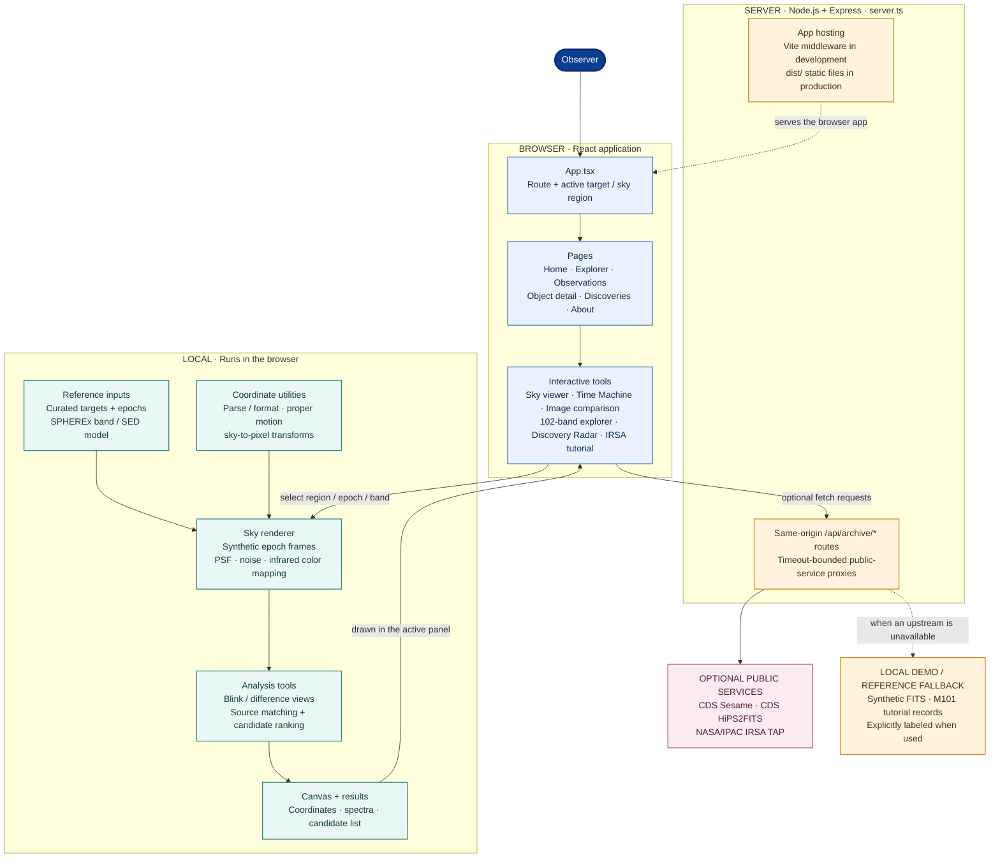
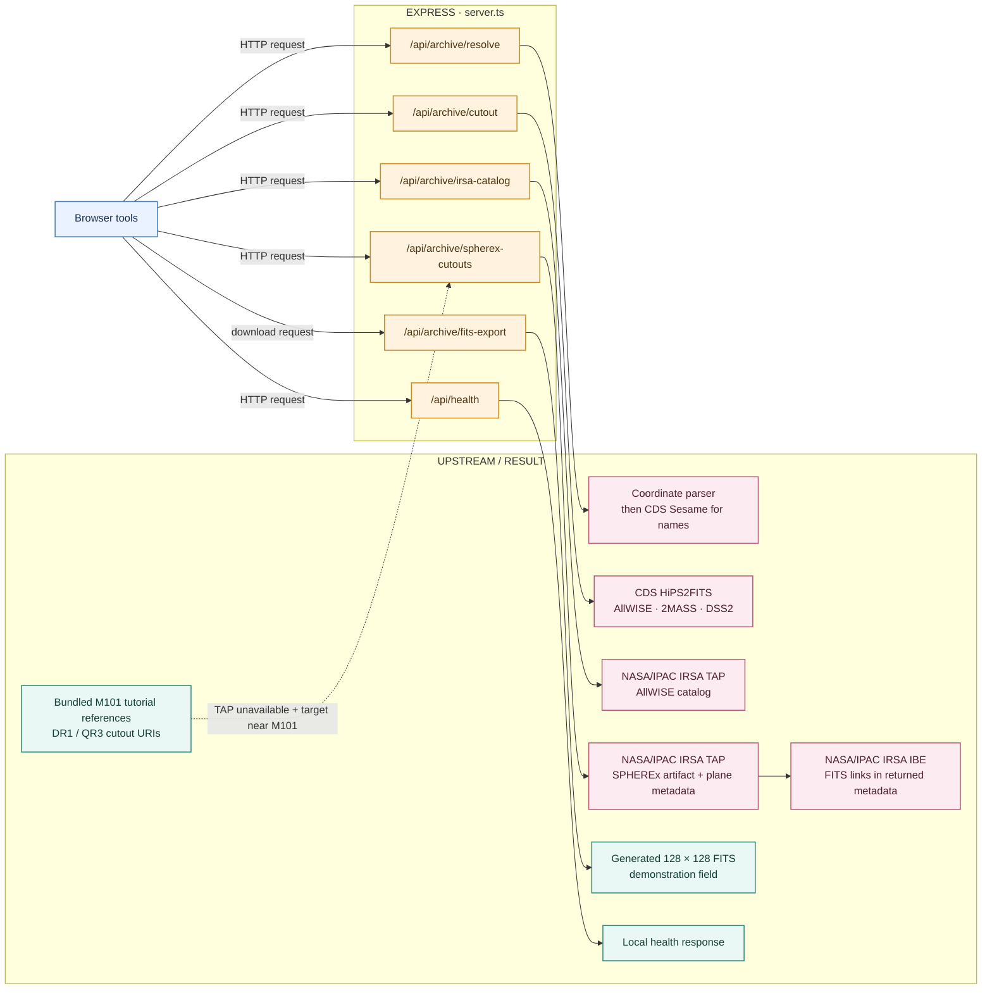

<div align="center">

# AFTERLIGHT

### Explore the changing infrared universe — one observation at a time

**A NASA Space Apps Challenge 2026 project · Planet X and SPHEREx**

AFTERLIGHT is an interactive astronomical exploration workbench for studying how
celestial objects move and change brightness across observation epochs and infrared
wavelengths. It brings a sky viewer, a 102-band SPHEREx reference model, public
archive lookups, and a transparent moving-object candidate pipeline into one
browser-based experience.

[Explore the architecture](#system-architecture) ·
[Run locally](#run-locally) ·
[Data and scientific integrity](#data-and-scientific-integrity)

</div>

> **Project status:** Challenge prototype / research and education interface.
> Several sky plates, spectra, and epochs are deterministic demonstrations rather
> than downloaded science products. Candidate detections are unconfirmed and are
> not astronomical discoveries.

---

## What it does

- **Explore a sky region.** Search curated targets, enter J2000 coordinates in
  decimal degrees or sexagesimal form, or resolve an object name with CDS Sesame.
- **Inspect an interactive sky plate.** Pan and zoom, inspect cursor coordinates,
  toggle a WCS-style grid and target markers, and adjust infrared wavelength.
- **Travel through time.** Step or play through curated epochs to see modeled proper
  motion and brightness changes.
- **Compare epochs.** View two frames side by side, blink between them, or inspect a
  signed difference image with alignment and display controls.
- **Explore SPHEREx wavelengths.** Browse 102 modeled channels across six detector
  arrays from 0.75 to 5.00 µm, with reference spectral energy distributions and
  molecular-feature annotations.
- **Review moving-object candidates.** Extract point sources from two rendered
  epochs, match static sources, rank displaced sources, and set a review status.
- **Query public archives.** When network access is available, request CDS HiPS
  survey cutouts and NASA/IPAC IRSA AllWISE or SPHEREx TAP results.
- **Export products.** Download the displayed canvas as PNG or request a
  standards-aligned demonstration FITS image from the local API.

## System architecture

AFTERLIGHT has two separate execution paths: **local analysis in the browser** and
**optional archive requests through the server**. The first diagram shows the main
application layers; the second isolates the API integrations and their fallbacks.



### Archive request paths

Each arrow below is one independent request path. The browser calls the local API;
only the server calls public services. The dashed M101 path is a demonstration
fallback, not a live SPHEREx result.



The React app keeps navigation and selection state in memory (no client-side router
or database). Sky rendering, epoch comparisons, and candidate extraction run locally;
network access is only needed for name resolution and optional archive queries.
Development serves the app through Vite middleware, while production serves the
built `dist/` files from Express.

## Science and analysis features

### Sky coordinates and motion

`src/lib/astronomy.ts` parses RA and declination in decimal degrees or sexagesimal
formats, formats coordinate readouts, computes great-circle angular separation,
propagates proper motion from a reference epoch, and converts between sky
coordinates and viewer pixels using a small-field tangent-plane approximation.

### Synthetic observation renderer

`src/lib/skyRenderer.ts` seeds a reproducible background field from sky coordinates,
then renders stars, faint galaxy-like sources, a target, wavelength-dependent
brightness, a point-spread function, and deterministic sky grain into a `Float32Array`.
The viewer maps that buffer to an asinh-stretched, false-color canvas. It is an
interactive **demonstration renderer**, not a calibrated SPHEREx instrument simulator
or a substitute for archival image data.

### SPHEREx reference model

`src/lib/spherex.ts` defines six detector arrays and generates 102 wavelength
channels over 0.75–5.00 µm. The wavelength explorer computes deterministic reference
SED curves from blackbody-like shapes and illustrative molecular or dust features
for supported target classes. These curves are labeled as reference models, not
observed SPHEREx spectra.

### Discovery Radar

`src/lib/detection.ts` estimates background level and noise from sampled pixels,
detects local maxima above an SNR threshold, computes intensity-weighted centroids,
matches near-stationary sources between frames, and ranks remaining displaced
sources as candidates. Results include positions, displacement, estimated motion,
SNR, confidence score, and review status. The pipeline operates on the app's
rendered demonstration frames; it is an educational prototype, not a validated
survey discovery pipeline.

### Archive and export API

All endpoints are implemented in `server.ts`:

| Endpoint | Purpose | Live source / behavior |
| --- | --- | --- |
| `GET /api/health` | Service health and timestamp | Local server |
| `GET /api/archive/resolve?q=...` | Accept coordinate pairs or resolve object names | Local parser, then CDS Sesame |
| `GET /api/archive/cutout?ra=...&dec=...&fov=...&survey=...` | Retrieve an archival sky cutout | CDS HiPS2FITS; allow-listed AllWISE, 2MASS, DSS2 |
| `GET /api/archive/irsa-catalog?ra=...&dec=...&radiusArcsec=...` | Query nearby AllWISE sources | NASA/IPAC IRSA TAP, `allwise_p3as_psd` |
| `GET /api/archive/spherex-cutouts?ra=...&dec=...&sizeDeg=...&bandpass=...` | Find matching SPHEREx cutout metadata and URIs | NASA/IPAC IRSA TAP, `spherex.artifact` joined with `spherex.plane`; M101 tutorial references can be used as fallback |
| `GET /api/archive/fits-export?ra=...&dec=...&fov=...&epoch=...&band=...&targetName=...` | Download a FITS-format product | Locally generated demonstration Gaussian field; **not an archive cutout** |

Public-service calls have short timeouts. Some endpoints return a demonstration
status or reference rows when the upstream is unavailable; the UI also surfaces
provenance labels so those results are not silently presented as live observations.
The SPHEREx tutorial data is based on the
[Caltech/IPAC IRSA SPHEREx cutouts tutorial](https://caltech-ipac.github.io/irsa-tutorials/spherex-cutouts/).

## Project structure

```text
.
├── server.ts                     # Express API, archive proxies, FITS export, Vite host
├── index.html                    # Document metadata and React mount point
├── vite.config.ts                # React + Tailwind Vite plugins and aliases
├── package.json                  # Scripts and dependencies
├── src/
│   ├── main.tsx                  # React entry
│   ├── App.tsx                   # App state, navigation, target resolution
│   ├── index.css                 # Tailwind import and global styles
│   ├── assets/images/            # Illustrative plates and M101 tutorial preview
│   ├── components/               # Viewer, comparison, timeline, radar, layout panels
│   ├── data/
│   │   ├── objects.ts            # Curated objects, epoch metadata, target lookup
│   │   └── spherexTutorialDataset.ts # M101 DR1/QR3 reference records and ADQL
│   ├── lib/
│   │   ├── astronomy.ts          # Coordinate parsing, motion, separation, WCS helpers
│   │   ├── detection.ts          # Point-source extraction and candidate matching
│   │   ├── skyRenderer.ts        # Deterministic sky-field renderer and color mapping
│   │   ├── spherex.ts            # 102-band reference model and SED calculations
│   │   └── lenisContext.tsx      # Smooth-scroll provider
│   └── pages/                    # Home, Explorer, Observations, Detail, Discoveries, About
└── README.md
```

## Run locally

### Requirements

- Node.js compatible with Vite 8 (Node.js 20.19+ or 22.12+)
- npm
- Network access is optional; live name resolution and archive queries require
  external services to be reachable.

### Install and start

```bash
npm install
npm run dev
```

Open the URL printed by the server (by default, `http://localhost:3000`). The
development script runs `server.ts` with `tsx`; Vite is mounted as middleware.

### Build and serve production output

```bash
npm run build
```

To serve the generated `dist/` directory through Express, start the app with
`NODE_ENV=production` set in the environment. The server listens on port `3000` by
default; set `PORT` to override it.

### Checks

```bash
npm run lint
npx tsx --test src/lib/astronomy.test.ts src/data/spherexTutorialDataset.test.ts
```

`lint` runs the TypeScript compiler in no-emit mode. The test files cover coordinate
parsing and transforms, proper motion, SPHEREx band generation, the demonstration
moving-source pipeline, and the M101 tutorial dataset and query builder.

## Data and scientific integrity

- **Live archive data and modeled data are different.** The app can request select
  public archival products and catalog metadata, but its canvas sky plates and
  reference SED curves are generated locally.
- **Epoch metadata is not proof of downloaded pixels.** Curated WISE/NEOWISE and
  SPHEREx epoch entries provide context for the demonstration timeline; do not treat
  every rendered epoch as an actual retrieved survey exposure.
- **SPHEREx integration has boundaries.** The app models the six-array, 102-channel
  wavelength layout and queries public SPHEREx cutout metadata. It does not currently
  ingest live SPHEREx FITS pixel arrays into the interactive sky renderer.
- **FITS export is a demo product.** The export endpoint writes a small generated
  float32 field with coordinate and band metadata. It is not downloaded science data
  or a calibrated instrument observation.
- **Candidates need independent confirmation.** Offsets can arise from rendering,
  noise, source blending, detector artifacts, or catalog mismatches. Validate any
  real target against astrometric catalogs and appropriate follow-up; this interface
  does not establish a planet or other discovery.
- **External dependencies can be unavailable.** Public endpoints may be inaccessible
  due to network, service, or runtime conditions. The app is designed to report
  demonstration/reference behavior in those cases.

AFTERLIGHT was developed for the NASA Space Apps Challenge 2026. It is an independent
challenge project and is not an official NASA product or an endorsement by NASA,
JPL-Caltech, Caltech/IPAC, or CDS.

## Acknowledgements

The project references public astronomy services and mission/archive material from
NASA and JPL-Caltech, NASA/IPAC IRSA, AllWISE/NEOWISE, 2MASS, ESA Gaia, CDS Strasbourg,
and the Caltech/IPAC SPHEREx cutouts tutorial. See the in-app About page and
individual dataset references for more context.
